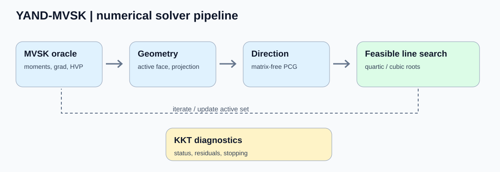
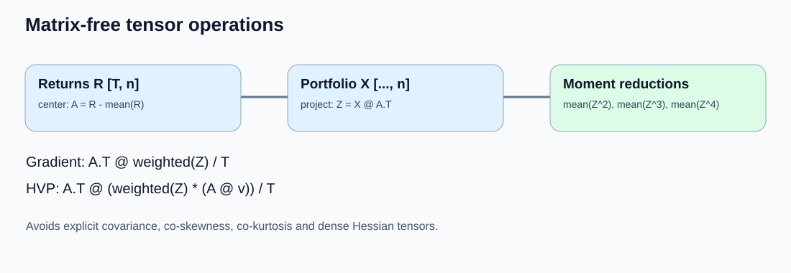
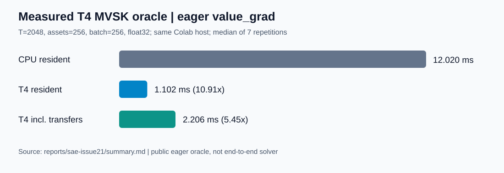

# TorchYAND

[English](README.md) | [简体中文](README.zh-CN.md)

**Tensorized higher-moment portfolio optimization in native PyTorch.**

TorchYAND implements Yau's Affine-Normal Descent (YAND) for mean–variance–skewness–kurtosis (MVSK) portfolio optimization. It combines matrix-free derivative operators, simplex geometry, batched iterative linear algebra, polynomial line search, and KKT diagnostics in a CPU/CUDA-capable numerical library.

   

**Explore:** [Mathematical design](TorchYAND_MVSK_Design_Spec.md) · [Benchmarks](benchmarks/) · [Measured T4 pilot](reports/sae-issue21/summary.md) · [Evidence and figure provenance](docs/assets/README.md)

## Highlights

- **Higher moments without higher-order moment tensors:** objective, gradient, Hessian-vector products (HVP), and third-order directional actions use centered-return projections.
- **Matrix-free constrained optimization:** affine-normal directions, active-face simplex projections, projected Hessian operators, and batched PCG.
- **Polynomial numerics:** cubic real-root solvers and feasible quartic line search.
- **PyTorch-native execution:** float32/float64, CPU/CUDA, and leading portfolio batch dimensions.
- **Inspectable convergence:** explicit solver statuses, KKT residuals, and reproducible benchmark entry points.

## Mathematical model

For a return matrix `R ∈ ℝ^(T×n)`, mean return `μ`, centered matrix `A = R − 1μᵀ`, portfolio `x`, and `z = Ax`, the implemented sample-moment objective is

```text
minimize  f(x) = -c1 * μᵀx + c2 * mean(z²) - c3 * mean(z³) + c4 * mean(z⁴)
subject to x >= 0,  1ᵀx = 1;   c1,c2,c3,c4 >= 0
```

These are **central sample moments**, not standardized skewness or excess kurtosis. The public oracle accepts shared coefficients `[c1,c2,c3,c4]` and computes analytical derivatives without materializing covariance, co-skewness, co-kurtosis, or dense Hessian tensors. For example, with `w = 2c2 − 6c3 z + 12c4 z²`,

```text
∇f(x) = -c1 μ + Aᵀ(2c2 z − 3c3 z² + 4c4 z³)/T
∇²f(x)v = Aᵀ(w ⊙ (Av))/T
```

See the [design specification](TorchYAND_MVSK_Design_Spec.md) for geometry, stochastic/exact logdet correction, and polynomial derivations.

## Algorithm architecture



The production v0.1 solver is **eager**, with adaptive PCG and active-set handling. The flow combines an MVSK oracle, affine-normal direction construction, feasible quartic search, and full-simplex KKT diagnostics. The diagram summarizes components rather than a literal call graph.



The matrix-free oracle reuses `Z = X @ A.T` across moment reductions and derivatives. Its projected-return representation supports leading batch dimensions while keeping the asset dimension fixed.

## Installation and quick start

Install from a checkout (Python >=3.10, PyTorch >=2.0 declared):

```bash
pip install -e .
```

```python
import torch
from torchyand import prepare_mvsk_data, MVSKOracle
from torchyand.solver import (
    YANDOptions,
    solve_yand,
    SolverStatus,
)

rng = torch.Generator().manual_seed(123)

returns = 0.01 * torch.randn(
    256,
    16,
    dtype=torch.float64,
    generator=rng,
)

data = prepare_mvsk_data(returns)

oracle = MVSKOracle(
    data,
    coefficients=[1.0, 1.0, 0.2, 0.1],
)

x0 = torch.full(
    (16,),
    1 / 16,
    dtype=returns.dtype,
)

result = solve_yand(
    oracle,
    x0,
    options=YANDOptions(
        logdet_mode="stochastic",
    ),
    seed=123,
)

print(
    SolverStatus(result.status.item()).name,
    result.converged.item(),
)

print(result.x)
print(result.value.item())
print(result.kkt_residual.item())
```

`prepare_mvsk_data` and `MVSKOracle` are available from `torchyand`; `solve_yand`, `YANDOptions`, `YANDMVSK`, `YANDResult`, and `SolverStatus` are in `torchyand.solver`. `result.converged`, `result.status`, and `result.kkt_residual` describe termination. For nonconvex MVSK, KKT convergence means stationarity rather than global optimality.

## Performance: measured CPU and Tesla T4



A [recorded same-Colab-host scientific pilot](reports/sae-issue21/summary.md) timed the **public eager MVSK `value_grad` oracle** at `T=2048`, `n=256`, batch 256, float32. Two warmups and seven synchronized measurements were taken per scope:

| Scope | Median | CPU-relative ratio |
|---|---:|---:|
| CPU resident, 2 threads | 12.020 ms | 1.00× |
| T4 resident compute | 1.102 ms | 10.91× |
| T4 including transfers, oracle construction and result return | 2.206 ms | 5.45× |

The CPU and T4 runs used the same Colab host and matching data. These are **oracle timings, not full-solver timings**; generation and centering were excluded. The [source report](reports/sae-issue21/summary.md) records parity checks, environment, timings, and exact source pins. Its scientific acceptance was pending at publication.

A separate **experimental compiled fixed-PCG** repeated-solve benchmark reported approximately **22.9 s → 9.6 s (2.38×)** on T4, with ~11 minutes of cold compilation and ~51-solve estimated break-even. That path does **not** replace the default eager adaptive solver; its provenance currently appears in the [historical README at the pinned baseline](https://github.com/JohnnyZPiggy/TorchYAND/blob/1ee2a100db61bc3be62ced9cc7923f261b512b35/README.md) and the [benchmark entry point](benchmarks/bench_yand_compiled_pcg.py).

## Research applications

TorchYAND offers reusable numerical patterns beyond a single portfolio model:

| Direction | Relevant building blocks |
|---|---|
| Higher-moment asset allocation | Mean, variance, third and fourth central moments under simplex constraints |
| Batched constrained optimization | Active-set masks, projected operators, KKT monitoring |
| Differentiable-model analysis | Analytical gradient, HVP and third-order actions; separate training integration required |
| GPU numerical research | Tensorized polynomial solvers, matrix-free PCG, and controlled compile experiments |

These are research directions; the shipped solver targets MVSK portfolio optimization.

## Solver, validation and scope

| Component | Status |
|---|---|
| MVSK oracle, derivatives, geometry, polynomial solvers | Implemented |
| Eager YAND solver with adaptive PCG, simplex constraints and KKT statuses | Implemented |
| Experimental compiled fixed-PCG benchmark | Research-only |
| Historical TPU/XLA harness | Retained research history, not an endorsed production backend |

The recorded Colab T4 validation environment (PyTorch 2.11.0+cu130) passed **1,269 tests**. The newer [SAE scientific pilot](reports/sae-issue21/summary.md) separately reports a four-test CPU gate and bounded CPU/CUDA oracle and quadratic-solver checks; these are distinct experiments.

Supported tensor dtypes are float32/float64; portfolios use `[..., n]` with shared four coefficients. Device/dtype must match the oracle. Solver termination statuses include `CONVERGED_KKT`, `STALLED`, `MAX_ITER`, `DIRECTION_FAILED`, `LINE_SEARCH_FAILED`, and `INVALID_STATE`. Float64 is recommended for stringent convergence work.

```bash
pip install -e ".[test]"
python -m pytest tests/ -q
```

For performance reproduction, inspect [benchmark scripts](benchmarks/) and their measurement scopes. Compiled experiments are optional and require an appropriate compiler environment.

## Project layout

```text
torchyand/
  data/         oracle/       geometry/       operators/
  linalg/       logdet/       polynomial/     constraints/
  line_models/  line_search/  diagnostics/    solver/
tests/          benchmarks/   experiments/    reports/
```

## License

MIT — see [LICENSE](LICENSE). Research reports and historical experimental records are preserved separately from the public API.
